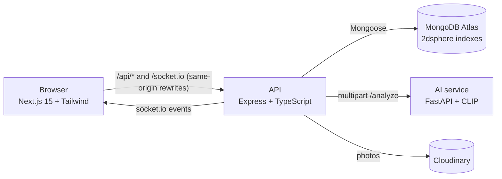

# 🐾 PawRescue

**Report an injured animal in seconds. The nearest verified NGO rescues it, and you follow its recovery live.**

A full-stack animal rescue platform with role-based dashboards, geospatial NGO matching, real-time updates, an AI triage service, and an analytics dashboard.

## Features

| Area | What it does |
|---|---|
| **Reporters** | Photo + GPS report with a draggable map pin, SOS mode via one-tap Google sign-in, live progress tracker, treatment timeline with photos |
| **NGOs** | Incoming requests on a map sorted by emergency, severity and distance; atomic "accept" (no double dispatch); status flow; treatment updates with photos |
| **Admin** | NGO verification queue, all-requests view (open / unassigned / escalated), analytics dashboard, one-click demo data |
| **Geo matching** | MongoDB `2dsphere` + `$geoNear`: a report reaches approved NGOs whose own service radius covers it |
| **Real-time** | socket.io rooms per user/admin, notification bell, toasts, optional desktop alerts |
| **Escalation** | Unaccepted after 10 min (SOS: 5) → NGOs within 30 km + admins are alerted |
| **AI triage** | CLIP zero-shot species + injury detection, explainable 0–100 severity score with reasons, species auto-fill, duplicate detection (location + time + image similarity) |
| **Analytics** | KPIs (rescue rate, median time to accept/rescue), trend, species, severity, weekday × hour heatmap, incident map, NGO leaderboard, auto-generated insights, CSV export |
| **Security** | httpOnly JWT cookie, role checks on API + Next.js middleware, short-lived socket tokens, Zod validation, rate limiting, helmet |

## Architecture



- **web/**: Next.js App Router, TypeScript, Tailwind, shadcn-style UI, Framer Motion, Leaflet/OpenStreetMap, Recharts
- **api/**: Express, Mongoose, Zod, socket.io, multer; layered routes → controllers → services → models
- **ml/**: FastAPI, PyTorch, Hugging Face `openai/clip-vit-base-patch32`

### How the AI triage works
1. **Species**: each label (dog, cat, cow…) is described by several prompts; CLIP compares the photo to the averaged text embeddings (prompt ensembling, no training data needed).
2. **Injury**: same approach with "injured / bleeding / hit by a car" vs "healthy" prompt sets.
3. **Severity score (0–100)**: description keywords (with negation handling, e.g. "not bleeding") + photo injury probability + SOS flag, returned with human-readable reasons. The NGO always has the final say.
4. **Duplicates**: same area (500 m), last 48 h, still open, and image-embedding cosine similarity ≥ 0.9 → linked to the original case; NGOs aren't re-alerted, and the second reporter follows the original.
5. If the AI service is down, the API falls back to keyword triage, so reporting never breaks.

## Run locally (Windows)

Requirements: Node 20+, Python 3.12, a MongoDB Atlas cluster.

```powershell
npm install
copy api\.env.example api\.env     # fill MONGODB_URI, JWT_SECRET, ADMIN_EMAIL, ADMIN_PASSWORD
copy web\.env.example web\.env.local  # JWT_SECRET must match api/.env
npm run setup:ml                   # one-time: Python venv + PyTorch + transformers
npm run dev                        # web :3000, api :5000, ml :8000
```

The first admin is created on startup from `ADMIN_EMAIL` / `ADMIN_PASSWORD`. In **Admin → Analytics**, click **Load demo data** for ~230 synthetic reports (flagged and removable; they never reach real NGOs).

## Deploy (free tiers)

| Part | Host | Notes |
|---|---|---|
| Database | MongoDB Atlas M0 | Network Access: allow `0.0.0.0/0` (Render IPs change) |
| API | Render (`render.yaml`) | Set env vars in the dashboard; `CLIENT_ORIGIN` = your Vercel URL |
| Web | Vercel, root directory `web` | `API_URL` = Render URL, `JWT_SECRET` = same as API |
| AI | Hugging Face Spaces (Docker, `ml/Dockerfile`) | Set the API's `ML_URL` to the Space URL |
| Photos | Cloudinary | Required in production (Render's disk is temporary) |

Live updates go through the web origin (`/socket.io` rewrite, long-polling). To use direct WebSockets in production, set `NEXT_PUBLIC_SOCKET_URL` to the API URL.

## Project structure

```
api/src   config · models · routes · controllers · services (geo, realtime, escalation, ml, analytics, demo) · middleware
web/src   app (auth pages, /sos, dashboard/{user,ngo,admin}) · components (map, rescue, dashboard, ui) · lib
ml/app    main.py (FastAPI) · model.py (CLIP) · labels.py (prompt sets) · severity.py (explainable scoring)
```
